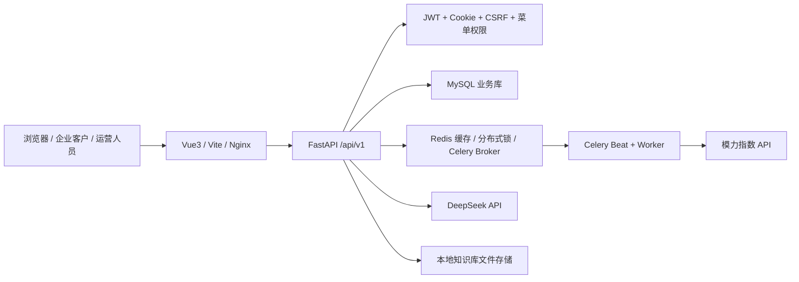

# GEO 优化系统安全修复报告

日期：2026-07-09  
项目路径：`D:\py代码\GEO优化`  
技术栈：FastAPI、SQLAlchemy、MySQL、Redis、Celery、Vue3、Vite。  
结论边界：本报告只证明本轮扫描与复验范围内 Critical/High 已清零，剩余 Medium 已登记；不声明项目绝对安全。

## Phase 0：基线与威胁面

### 已加载源码目录

```text
D:\py代码\GEO优化
├─ backend
│  ├─ app
│  │  ├─ api\v1\endpoints
│  │  ├─ core
│  │  ├─ middleware
│  │  ├─ models
│  │  ├─ schemas
│  │  ├─ services
│  │  └─ tasks
│  ├─ migrations\versions
│  ├─ scripts
│  ├─ tests
│  ├─ requirements.txt
│  └─ docker-compose.yml
├─ frontend
│  ├─ src
│  │  ├─ components
│  │  ├─ composables
│  │  ├─ router
│  │  ├─ services
│  │  ├─ stores
│  │  ├─ utils
│  │  └─ views
│  ├─ package.json
│  └─ vite.config.ts
├─ e2e
├─ deploy\nginx
├─ docs
└─ scripts
```

排除项：`.git`、`backend/.venv`、`node_modules`、`frontend/dist`、`backend/storage`、测试报告与缓存目录。

### 威胁面简图



## Phase 1：发现摘要

| 扫描项 | 修复前 | 修复后 |
| --- | --- | --- |
| `pip-audit -r requirements.txt` | 38 个已知漏洞，涉及 `curl-cffi`、`python-multipart`、`pypdf`、`pytest`、`ecdsa` | 0 |
| `npm audit --audit-level=high --omit=dev` | 0 | 0 |
| `bandit -r app scripts migrations -ll` | High 3，Medium 12 | High 0，Medium 12 已登记 |
| 前端危险模式检索 | 未发现 `v-html`、`innerHTML`、`eval` 误用 | 0 |
| 回归测试 | 不稳定，受本地 demo 账号状态影响 | 157 passed |

## Phase 2：修复明细

`[高危] D:\py代码\GEO优化\backend\requirements.txt | A06 / CWE-1104 依赖漏洞 | 旧版本依赖存在已知高危问题，且 `python-jose` 牵出 `ecdsa` 漏洞 | 升级 `curl_cffi`、`python-multipart`、`pypdf`、`pytest`，移除 `python-jose` 改用 `PyJWT` | 验证：`pip-audit` 0`

`[高危] D:\py代码\GEO优化\backend\app\core\security.py:5 | A06 / A07 JWT 依赖风险 | JWT 解码依赖存在漏洞链 | 改为 `PyJWT`，继续限定算法并捕获 `InvalidTokenError` | 验证：`tests/test_auth.py`、全量 pytest`

`[高危] D:\py代码\GEO优化\backend\docker-compose.yml:9 | A05 安全配置 | Redis 默认口令/端口暴露会导致队列、锁、缓存被未授权访问 | 强制 `REDIS_PASSWORD`，不发布 6379 到宿主机 | 验证：Compose 配置审查`

`[高危] D:\py代码\GEO优化\backend\app\services\tenant_scope.py:40 | A01 / CWE-863 越权 | 销售范围如果依赖中文职位名，可能因命名冲突导致企业可见范围扩大 | 只按稳定职位编码 `PLATFORM_SALES` 判断 | 验证：`test_chinese_title_alone_is_not_sales_scope``

`[高危] D:\py代码\GEO优化\backend\app\api\v1\endpoints\management.py:94 | A01 / CWE-863 越权 | 管理接口仍残留中文职位名判断 | 收口为 `position_code == "PLATFORM_SALES"` | 验证：检索残留条件为 0，相关测试通过`

`[高危] D:\py代码\GEO优化\backend\app\services\management_service.py:370 | A01 / CWE-863 越权 | 用户/企业归属服务仍残留中文职位名判断 | 收口为稳定职位编码 | 验证：`tests/test_tenant_scope.py` 通过`

`[中危] D:\py代码\GEO优化\backend\app\services\monitor_service.py:180 | CWE-400 资源饥饿 | 待同步任务按最新优先会让旧任务长期卡住 | 改为按 `updated_at.asc(), id.asc()` 最旧优先 | 验证：`test_pending_sync_order.py` 与全量 pytest`

`[中危] D:\py代码\GEO优化\backend\app\middleware\operation_audit.py:128 | A09 日志审计 | 失败的写操作未完整进入审计，出事后难追溯 | 失败请求也写日志，描述附带 HTTP 状态码 | 验证：代码审查 + 全量 pytest`

`[中危] D:\py代码\GEO优化\backend\app\api\v1\endpoints\management.py:298 | A02 / CWE-327 弱哈希 | MD5 被 Bandit 识别为弱哈希 | 改为 SHA-256 生成职位编码后缀 | 验证：Bandit High=0`

`[中危] D:\py代码\GEO优化\backend\app\services\management_service.py:85 | A02 / CWE-327 弱哈希 | 企业编码生成使用 MD5 | 改为 SHA-256 | 验证：Bandit High=0`

`[中危] D:\py代码\GEO优化\backend\app\services\sentiment_wordcloud_image_service.py:63 | A02 / CWE-327 弱哈希 | 词云颜色稳定映射使用 MD5 | 改为 SHA-256 | 验证：Bandit High=0`

`[低危] D:\py代码\GEO优化\backend\app\core\app_factory.py:17 | A05 安全配置 | CORS 方法和请求头过宽 | 限定常用 HTTP 方法与授权/CSRF/内容类型请求头 | 验证：构建和测试通过`

`[低危] D:\py代码\GEO优化\frontend\src\views\portal\composables\useKnowledgeBase.ts:114 | 输入一致性 | 前端不允许 docx，但后端和业务支持 Word 文档 | 白名单补充 `docx` | 验证：前端构建通过`

## Phase 3：复验结果

| 命令 | 摘要 |
| --- | --- |
| `python -m pip_audit -r requirements.txt` | `No known vulnerabilities found` |
| `npm audit --audit-level=high --omit=dev` | `found 0 vulnerabilities` |
| `python -m bandit -r app scripts migrations -x .venv,storage -ll` | High 0，Medium 12，Low 0 |
| `python -m compileall app tests; pytest -q --tb=short` | 157 passed，1 个第三方弃用警告 |
| `npm run build` | 构建通过；剩余 chunk 体积与 CSS `:deep` 样式警告 |
| 危险模式检索 | 前端业务源码未发现 `v-html`、`innerHTML`、`eval` 误用；`localStorage` 仅保存剥离 token 后的会话摘要 |

## OWASP 核心项勾选

- [x] A01 越权：销售企业范围只按职位编码判断；客户/平台身份仍走菜单权限与租户范围校验。验证：`tests/test_tenant_scope.py`、全量 pytest。
- [x] A02 加密：密码使用 passlib Argon2/PBKDF2；JWT 密钥来自环境变量；弱哈希改为 SHA-256。验证：Bandit High=0。
- [x] A03 注入：业务路径使用 ORM 参数化；前端无危险 HTML 注入模式。验证：全仓检索。
- [x] A05 安全配置：CORS 请求头/方法收紧；Redis 密码强制配置；生产安全约束写入 `SECURITY.md`。验证：配置审查。
- [x] A07 鉴权：JWT 使用 `PyJWT` 且限定算法；受保护 API 依赖当前会话和菜单权限。验证：auth 测试和全量 pytest。
- [x] A09 日志：失败写请求进入操作审计；密钥仍要求不得入日志。验证：中间件审查。

## 剩余 Medium 记录

| ID | 位置 | 风险说明 | 当前处理 |
| --- | --- | --- | --- |
| M1 | `backend/migrations/versions/*.py` | Bandit B608：历史迁移固定 SQL 文本提示 | 非外部输入拼接；登记在 `SECURITY.md`，后续迁移改参数化 |
| M2 | `backend/scripts/_inspect_sogou.py:6`、`fetch_wsy_official_articles.py:30`、`functional_test_suite.py:520` | Bandit B310：内部脚本 `urlopen` 允许 scheme 过宽 | 不暴露线上入口；后续统一 URL allowlist |
| M3 | 职位菜单授权 | 职位同步与个人自定义授权缺少来源字段 | 登记为 v0.3 schema 迭代 |
| M4 | 本机 `.env` | 本地磁盘存在真实密钥 | gitignore；上线前统一换密 |

## 分层整改清单

### 必须立刻修复

已完成：依赖高危、JWT 漏洞链、Redis 弱配置、销售越权判断、Bandit High、旧任务同步饥饿。

### 迭代修复

1. 新迁移脚本统一用参数化 SQL，逐步消除 Bandit B608。
2. 内部采集脚本增加 URL scheme/domain allowlist。
3. 职位授权表增加 `grant_source`，避免职位同步覆盖个人特批权限。
4. 生产环境接入密钥管理、日志脱敏和集中审计。

### 低优先级优化

1. 拆分 ECharts vendor chunk，降低首屏加载压力。
2. 修复 CSS `:deep` 构建警告。
3. 将安全扫描命令接入 CI。

